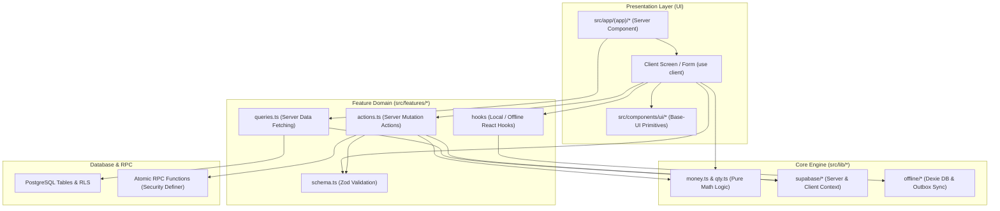

# Arsitektur Frontend: Bengkel & Toko Bangunan POS (PWA)

Dokumen ini adalah spesifikasi arsitektur frontend resmi untuk aplikasi Point of Sale (POS) & Manajemen Bengkel dan Toko Bangunan. Dokumen ini menjadi pedoman utama bagi developer dan model coding AI agar implementasi antarmuka konsisten, tidak menghasilkan template generik ("AI slop"), dan mematuhi batasan teknis yang telah ditetapkan.

---

## 1. Tujuan Dokumen & Cakupan Frontend

### 1.1 Tujuan
- Memberikan panduan arsitektur frontend yang terstandarisasi untuk Next.js 16 App Router.
- Menjadi kontrak kerja implementasi saat mendelegasikan task ke AI coding assistant/developer lain.
- Memastikan antarmuka terasa ergonomis, fungsional, dan dirancang khusus untuk operasional riil kasir toko bangunan dan montir bengkel di lapangan.

### 1.2 Cakupan (Scope)
- **Cakupan Frontend**: Seluruh aplikasi di dalam folder `src/app/`, `src/features/`, `src/components/`, dan `src/lib/`.
- **Batas Luar**: Skema database PostgreSQL, fungsi RPC SQL, dan aturan Row-Level Security (RLS) di `supabase/` berada di bawah otoritas backend. Frontend hanya mengonsumsi dan mematuhi kontrak Supabase yang dihasilkan.

---

## 2. Ringkasan Temuan dari Repositori

Dasar temuan berasal dari inspeksi langsung terhadap file konfigurasi dan kode sumber yang ada:

| Aspek | Bukti / File Acuan | Status di Repo |
| :--- | :--- | :--- |
| **Framework & Versi** | `package.json`, `next.config.ts` | Next.js `16.4.3` (App Router, Turbopack), React `19.1.0`, TypeScript `5` strict. |
| **Styling & Theme** | `package.json`, `src/app/globals.css`, `components.json` | Tailwind CSS v4 (`@tailwindcss/postcss@^4`), `@import "tailwindcss";`, OKLCH theme variables, `style: "base-nova"`. |
| **UI Primitives** | `package.json`, `src/components/ui/button.tsx` | `@base-ui/react@^1.9.0` (bukan Radix UI legacy), `class-variance-authority@^0.7.1`, `cn@^0.5.0`, `lucide-react@^1.61.0`. |
| **PWA & Offline** | `package.json`, `src/app/sw.ts`, `src/lib/offline/*` | `serwist@^9.5.13`, `@serwist/turbopack@^9.5.13`, IndexedDB via `dexie@^4.4.7` (`bengkel-pos-db`). |
| **Data Fetching** | `package.json`, `src/lib/supabase/*`, `src/features/*/` | `@supabase/ssr@^0.12.7`, `@supabase/supabase-js@^2.118.0`, `@tanstack/react-query@^5.104.5`, Server Actions & Server Components. |
| **Uang & Angka** | `src/lib/money.ts`, `src/lib/qty.ts` | Wajib integer rupiah (`number` bulat TS, `bigint` DB). Qty desimal maks 3 digit. Dilarang float/toFixed untuk uang. |
| **Waktu & Bahasa** | `src/lib/datetime.ts`, `AGENTS.md` | Seluruh teks UI Bahasa Indonesia. Zona waktu default `Asia/Jakarta` (WIB). |
| **Pengujian** | `vitest.config.ts`, `playwright.config.ts`, `e2e/` | Vitest untuk unit test logic (`src/**/*.test.ts`), Playwright untuk E2E kasir (`e2e/*.spec.ts`). |

---

## 3. Asumsi dan Hal yang Belum Diketahui

### 3.1 Asumsi yang Digunakan
1. Pengguna mayoritas beroperasi menggunakan tablet (touchscreen 10–12 inci), laptop entry-level di kasir toko, atau smartphone Android oleh mekanik di bengkel.
2. Lingkungan kerja fisik memiliki pencahayaan bervariasi, kemungkinan layar berdebu atau tangan operator kotor/berminyak; UI harus mengutamakan keterbacaan tinggi (high contrast) dan target sentuh besar.
3. Jaringan internet di lokasi toko/bengkel sering kali lambat atau putus-nyambung; transaksi kasir tidak boleh terblokir oleh latensi jaringan.

### 3.2 Hal yang Belum Diketahui & Perlu Dikonfirmasi
1. **Modul Masa Depan [BELUM DIKETAHUI]**:
   - Kontrak data dan alur final untuk modul Bengkel / Work Order (`/bengkel` atau `/servis`), Pembelian / PO (`/pembelian`), Surat Jalan (`/pengiriman`), dan Laporan Akuntansi (`/laporan`).
2. **Katalog Komponen UI Primitives**:
   - Di repositori saat ini baru ada `button.tsx` di `src/components/ui/`. Belum diputuskan apakah komponen form lainnya (Dialog, DropdownMenu, Tabs, Sheet) akan dipasang menggunakan CLI `npx shadcn@latest add ...` dengan preset `@base-ui/react`, atau dibangun sendiri secara modular.
3. **Hardware Integrasi Kasir**:
   - Saat ini pencetakan struk menggunakan `window.print()` (58mm/80mm). Integrasi driver langsung ESC/POS via Web Bluetooth atau WebUSB ditandai untuk fase rilis lanjutan.

---

## 4. Keputusan Stack & Aturan Teknis

### 4.1 Status Keputusan (Fakta vs Rekomendasi)

```
[TERKUNCI DI REPO] Next.js 16 App Router + React 19 + TypeScript Strict
[TERKUNCI DI REPO] Tailwind CSS v4 + OKLCH CSS Variables
[TERKUNCI DI REPO] @base-ui/react sebagai fondasi primitives headless UI
[TERKUNCI DI REPO] Supabase SSR (Server Actions & Server Components)
[TERKUNCI DI REPO] Dexie (IndexedDB) + Serwist PWA untuk offline-first kasir
[TERKUNCI DI REPO] Seluruh kalkulasi uang via src/lib/money.ts (integer rupiah)
[REKOMENDASI]    Standarisasi layout UI berbasis Data Density System (Compact Desktop vs Touch POS)
[REKOMENDASI]    Form handling menggunakan React 19 useActionState + Zod schema resolver
[REKOMENDASI]    Penggunaan URL searchParams untuk state filter, sorting, dan pagination
```

### 4.2 Aturan Keras Teknis (Non-Negotiable)
1. **Dilarang Floating Point untuk Uang**:
   - Dilarang keras menulis rumus matematika uang manual atau memakai `toFixed()` untuk kalkulasi. Gunakan `formatRupiah()`, `parseRupiah()`, dan `mulQty()` dari `@/lib/money`.
2. **Idempotensi Transaksi**:
   - Seluruh mutasi transaksi (penjualan, cicilan, pembayaran) wajib menghasilkan `client_uuid` (UUID v7) di client sebelum dikirim ke backend.
3. **No Direct Supabase Query in UI**:
   - Komponen UI tidak boleh mengimpor `@supabase/supabase-js` atau memanggil query database langsung. Akses data hanya boleh melalui file `queries.ts` atau `actions.ts` di feature domain terkait.
4. **Validasi Tunggal (Single Source of Truth)**:
   - Skema Zod di `src/features/<domain>/schema.ts` wajib digunakan bersama oleh client form dan server action.

---

## 5. Prinsip Desain UI: Anti "AI Slop" & Berorientasi Lapangan

Antarmuka generik buatan AI ("AI slop") biasanya memiliki ciri: padding raksasa tanpa fungsi, font abu-abu pudar tipis, kartu statis dengan diagram dekoratif yang tidak berguna bagi kasir, serta ketergantungan penuh pada mouse. Aplikasi ini menerapkan filosofi desain **Alat Kerja Lapangan (Industrial Work-Tool)**:

### 5.1 Hierarki & Kerapatan Informasi (Data Density)
- **Tampilan Kasir (POS Screen)**: Mode *High-Density*. Maksimalkan luas pandang produk dan ringkasan keranjang. Minimalkan scroll. Informasi kunci (Total Belanja, Sisa Tagihan, Kembalian) ditampilkan dengan ukuran angka minimal `text-xl` hingga `text-3xl` berbobot tebal (`font-bold` / `font-black`).
- **Tampilan Administrasi & Daftar (Master Data/Piutang/Stok)**: Tabel terstruktur rapi dengan border pemisah yang jelas (`border-border`), teks tabular-nums untuk angka dan uang (`font-mono` atau `tabular-nums`), perataan kanan (`text-right`) untuk nominal uang/stok.

### 5.2 Tipografi & Warna
- **Font**: Geist Sans untuk antarmuka umum, Geist Mono untuk data kode, nomor invoice, barcode, dan angka finansial.
- **Warna Fungsional (Bukan Dekoratif)**:
  - *Primary (Netral Gelap)*: Tombol aksi utama, header navigasi.
  - *Destructive (Merah)*: Stok kritis/habis, tagihan lewat tempo, hapus/void.
  - *Amber / Kuning Tua*: Status parsial/tempo, peringatan batas limit kredit, transaksi butuh review.
  - *Emerald / Hijau Tua*: Status lunas, pembayaran sukses, kembalian tunai.
- **Kontras**: Hindari penggunaan warna abu-abu muda (`text-neutral-400`) untuk teks informasi penting. Gunakan kontras tinggi yang tetap terbaca jelas di bawah terik matahari atau lampu bengkel.

### 5.3 Ergonomi Sentuh & Alur Cepat Keyboard
- **Target Sentuh**: Semua tombol interaktif, baris item kasir, dan kontrol form memiliki tinggi minimal **44 px** (`h-11` atau `h-12`).
- **Keyboard-First di Layar Kasir**:
  - `F2`: Fokus ke kotak pencarian barang / scan barcode.
  - `F4`: Fokus ke pilihan pembayaran / nominal bayar.
  - `F8`: Tahan transaksi (Hold cart).
  - `Esc`: Batalkan modal / bersihkan input pencarian.
  - `Enter`: Konfirmasi aksi utama.
- **Tombol Cepat Uang Pas & Pecahan Kasir**: Sediakan shortcut bayar uang pas, Rp 50.000, Rp 100.000, atau lunas 100%.

### 5.4 Penanganan Cetak Fisik (Thermal Receipt & Kwitansi)
- Sediakan CSS `@media print` murni:
  - Sembunyikan header navigasi, sidebar, dan tombol aksi (`print:hidden`).
  - Format kertas struk roll 58mm / 80mm atau format formal A5 untuk kwitansi cicilan piutang.
  - Hapus background shadow dan margin berlebih saat mode cetak.

---

## 6. Arsitektur Aplikasi & Tanggung Jawab Modul

Aplikasi menggunakan arsitektur modular berbasis **Feature-Driven Structure**:



### Tanggung Jawab Tiap Lapisan:
1. **Server Component (`page.tsx`)**: Mengambil data awal via `queries.ts`, memeriksa hak akses/redirect auth, menyusun layout shell, dan mengalirkan initial data ke Client Component.
2. **Client Component (`*-screen.tsx`, `*-form.tsx`)**: Menangani interaktivitas, input event, optimistic update, shortcut keyboard, dan pemanggilan Server Actions.
3. **Feature Queries (`queries.ts`)**: Berjalan di server. Melakukan aggregasi data dari Supabase, memformat relasi data, dan menyajikan DTO yang siap dipakai komponen.
4. **Feature Actions (`actions.ts`)**: Mutasi data via Server Actions. Memvalidasi payload dengan Zod, memanggil RPC database atomik, merevalidasi cache halaman Next.js (`revalidatePath`).
5. **Core Library (`src/lib/`)**: Logika matematika murni (uang, kuantitas satuan dasar, formatting tanggal) dan client persisten (Dexie IndexedDB, Service Worker Serwist).

---

## 7. Usulan Struktur Folder Frontend

Struktur folder mempertahankan tata kelola repo yang sudah ada tanpa memindahkan file:

```
src/
├─ app/
│  ├─ (auth)/
│  │  └─ login/                 # Halaman login
│  ├─ (app)/                    # Route terproteksi dengan header navbar
│  │  ├─ layout.tsx             # App layout (session check, navigation bar)
│  │  ├─ page.tsx               # Dashboard tenant
│  │  ├─ kasir/                 # Layar POS + shift kasir
│  │  ├─ penjualan/             # Riwayat transaksi + detail struk/retur
│  │  ├─ piutang/               # Daftar piutang, detail cicilan, kwitansi
│  │  ├─ produk/                # Master produk, harga, tier, barcode, import
│  │  ├─ stok/                  # Manajemen stok, opname, adjustment, menipis
│  │  ├─ katalog/               # Kategori & unit satuan dasar
│  │  ├─ pelanggan/             # Master customer & limit piutang
│  │  ├─ pemasok/               # Master supplier
│  │  ├─ pengaturan/            # Profil usaha, outlet, staf, printer struk
│  │  ├─ bengkel/               # [BELUM DIKETAHUI - Placeholder Work Order]
│  │  ├─ pembelian/             # [BELUM DIKETAHUI - Placeholder PO Supplier]
│  │  ├─ pengiriman/            # [BELUM DIKETAHUI - Placeholder Surat Jalan]
│  │  └─ laporan/               # [BELUM DIKETAHUI - Placeholder Laporan Laba/Rugi]
│  ├─ globals.css               # Tailwind v4 setup & design tokens
│  └─ sw.ts                     # Serwist Service Worker
├─ components/
│  ├─ ui/                       # Reusable primitives (@base-ui/react + cva)
│  │  ├─ button.tsx             # (Ada di repo)
│  │  ├─ input.tsx              # (Rekomendasi task bertahap)
│  │  ├─ select.tsx             # (Rekomendasi task bertahap)
│  │  ├─ dialog.tsx             # (Rekomendasi task bertahap)
│  │  ├─ badge.tsx              # (Rekomendasi task bertahap)
│  │  └─ table.tsx              # (Rekomendasi task bertahap)
│  └─ shared/                   # Komponen lintas fitur (EmptyState, ErrorBanner)
├─ features/                    # Domain-Driven Feature Modules
│  ├─ ar/                       # Accounts Receivable (Piutang & Kwitansi)
│  ├─ catalog/                  # Kategori, Unit, Impor CSV
│  ├─ customers/                # Pelanggan
│  ├─ inventory/                # Stok fisik & pergerakan barang
│  ├─ pos/                      # Kasir, Cart, Checkout, Offline Sync
│  ├─ sales/                    # Penjualan, Struk, Retur, Void
│  ├─ shifts/                   # Buka/Tutup Kasir
│  ├─ staff/                    # Staf & Role Membership
│  ├─ suppliers/                # Pemasok
│  ├─ tenant/                   # Tenant & Onboarding
│  ├─ workorder/                # [BELUM DIKETAHUI - Placeholder Modul Bengkel]
│  └─ purchasing/               # [BELUM DIKETAHUI - Placeholder Modul Pembelian]
└─ lib/
   ├─ money.ts                  # Kalkulasi & format rupiah integer (KRITIS)
   ├─ qty.ts                    # Kalkulasi kuantitas desimal & konversi satuan
   ├─ datetime.ts               # Format waktu Asia/Jakarta
   ├─ offline/                  # Dexie catalog & outbox queue
   ├─ supabase/                 # Supabase client, server, types
   └─ utils.ts                  # Helper umum
```

---

## 8. Konvensi Komponen, Form, State & Styling

### 8.1 Konvensi Komponen
- Gunakan Server Component sebagai default di file `page.tsx`.
- Tambahkan `"use client"` hanya jika komponen membutuhkan:
  - State lokal (`useState`, `useReducer`).
  - Lifecycle atau effect (`useEffect`, event listener keyboard).
  - Web API browser (`window.print()`, IndexedDB, Audio).
  - Form action state (`useActionState`).

### 8.2 Form Handling & Validasi
- Gunakan React 19 `useActionState` bersama Server Action untuk form submit standar.
- Form input terikat dengan Zod Schema di `src/features/<domain>/schema.ts`.
- Tampilkan pesan error validasi langsung inline di bawah input yang bersangkutan (hindari dialog alert).

Contoh pola baku form:
```tsx
// Contoh pola form standar:
const [state, formAction, pending] = useActionState(saveAction, initialState);

<form action={formAction} className="space-y-4">
  <input type="hidden" name="tenantId" value={tenantId} />
  
  {state.error ? (
    <div className="rounded-md border border-destructive/30 bg-destructive/10 p-3 text-sm text-destructive" role="alert">
      {state.error}
    </div>
  ) : null}

  <div className="space-y-1">
    <label htmlFor="name" className="text-sm font-medium">Nama Barang</label>
    <input id="name" name="name" required className="h-11 rounded-md border border-input bg-background px-3" />
  </div>

  <Button type="submit" disabled={pending} className="h-11">
    {pending ? "Menyimpan..." : "Simpan"}
  </Button>
</form>
```

### 8.3 State Loading, Error, dan Empty State
- **Loading State**: Gunakan skeleton placeholder dengan dimensi serupa data aslinya atau indikator loading inline pada tombol aksi (`{pending ? "Memproses..." : "Bayar"}`).
- **Empty State**: Harus menyertakan kalimat instruksi yang jelas serta tombol aksi utama, contoh:
  > *"Belum ada pelanggan terdaftar. Tambah pelanggan pertama untuk mulai mencatat transaksi tempo."* `[+ Tambah Pelanggan]`
- **Error State**: Pesan kegagalan harus informatif dalam Bahasa Indonesia dan menyertakan solusi jika memungkinkan.

---

## 9. Komunikasi Frontend–Backend & Kontrak Data

### 9.1 Mekanisme Komunikasi
1. **Pola Baca (Read)**:
   - Dijalankan via Server Components memanggil `queries.ts`.
   - Menggunakan query builder Supabase (`createClient` dari `@/lib/supabase/server`).
2. **Pola Tulis Sederhana (Simple Mutation)**:
   - Dijalankan via Server Action (`actions.ts`).
   - Menyertakan `revalidatePath` untuk memperbarui cache halaman.
3. **Pola Transaksi Atomik Finansial & Stok (Critical RPC)**:
   - Wajib memanggil fungsi Postgres RPC via `supabase.rpc("nama_rpc", { ... })`.
   - Wajib mengirimkan `p_client_uuid` dari client untuk idempotensi.

### 9.2 Penanganan Kontrak API yang Belum Final
Jika suatu fitur frontend sedang dirancang namun backend/RPC belum selesai dibuat:
1. Buat definisi antarmuka TypeScript dan Zod Schema di file `schema.ts` fitur tersebut dengan label komentar `// TODO: Sync with backend migration [NOMOR]`.
2. Jangan mengarang endpoint palsu di luar konvensi Supabase.
3. Tandai tipe kembalian yang belum pasti dengan status `[BELUM DIKETAHUI]`.

---

## 10. Strategi Testing & Verifikasi Kualitas

Semua fitur baru harus dapat diverifikasi sebelum dianggap selesai. Repositori telah dilengkapi dengan infrastruktur pengujian:

1. **Pemeriksaan Statis (Lint & Typecheck)**:
   - `npm run typecheck` (Memvalidasi `tsc --noEmit` untuk Next.js dan Worker).
   - `npm run lint` (ESLint 9).
2. **Unit Test Logika (Vitest)**:
   - `npm run test` (Menguji fungsi di `src/lib/money.test.ts`, skema Zod, perhitungaan diskon/stok).
3. **End-to-End Test (Playwright)**:
   - `npm run e2e` atau `npx playwright test <nama-spec> --reporter=line`.
   - Pengujian alur transaksi di browser Chromium nyata (Headless/Headed).
   - Selalu reset database sebelum menjalankan suite E2E yang memodifikasi stok/saldo: `npm run db:reset`.

---

## 11. Urutan Implementasi Bertahap (Roadmap Frontend)

Implementasi frontend lanjutan dibagi ke dalam langkah-langkah terkendali:

1. **Tahap 1: Ekstraksi Reusable Form Primitives**:
   - Membangun komponen dasar `Input`, `Select`, `Textarea`, `Badge`, dan `Table` di `src/components/ui/` berbasis `@base-ui/react` untuk menggantikan elemen inline yang berulang.
2. **Tahap 2: Penyelesaian Modul Piutang & Pengingat (T5.3)**:
   - Menambahkan kartu piutang per pelanggan dan link generator WhatsApp untuk penagihan invoice jatuh tempo di `/piutang`.
3. **Tahap 3: Modul Pembelian / PO Supplier (Fase 6)**:
   - UI Pembuatan PO ke supplier, penerimaan barang bertahap, dan pencatatan hutang dagang.
4. **Tahap 4: Modul Bengkel & Work Order (Fase 7)**:
   - UI Pendaftaran kendaraan (plat nomor), papan antrean servis (Kanban/List), penugasan mekanik, dan konversi work order menjadi penjualan kasir.
5. **Tahap 5: Laporan & Analisis Usaha (Fase 8)**:
   - Dashboard ringkasan omzet, laba kotor, laporan piutang/hutang, dan ekspor CSV.

---

## 12. Aturan Delegasi Task ke Model Coding Lain

Ketika menugaskan sebuah task implementasi frontend kepada AI coding model (misalnya subagent, model lain, atau sesi chat baru), patuhi aturan berikut:

1. **Satu Sesi, Satu Task Spesifik**: Jangan meminta AI mengerjakan satu fase besar sekaligus. Pecah per sub-task (misal: "Hanya buat tampilan kartu piutang di T5.3").
2. **Kunci Batasan File**: Cantumkan secara eksplisit file apa saja yang boleh disentuh dan file yang dilarang diubah.
3. **Wajib Mematuhi Konvensi Uang**: Ingatkan model untuk selalu menggunakan `@/lib/money` untuk format dan kalkulasi rupiah.
4. **Wajib Menjalankan Verifikasi**: Instruksikan model untuk menjalankan `npm run typecheck` dan `npm run lint` sebelum melaporkan hasil.

---

## 13. Template Task Delegasi (Siap Pakai / Copy-Paste)

Gunakan template di bawah ini saat memberikan instruksi task baru kepada model coding lain:

```markdown
### TASK: [Nama Fitur / Kode Task, contoh: T5.3 Kartu Piutang Pelanggan]

#### 1. Tujuan
[Jelaskan tujuan spesifik fitur yang akan dibangun dalam 1-2 kalimat]

#### 2. Konteks & Referensi
- Ikuti pedoman arsitektur di `docs/FE_ARCHITECTURE.md` dan aturan di `AGENTS.md`.
- Bahasa antarmuka: 100% Bahasa Indonesia.
- Format uang: Wajib menggunakan `formatRupiah` dari `@/lib/money`. Dilarang float/toFixed.
- Tanggal: Wajib format WIB via `@/lib/datetime`.

#### 3. Area File yang Boleh Diubah
- Boleh dibuat/diubah:
  - `src/features/[domain]/...`
  - `src/app/(app)/[route]/...`
  - `e2e/[nama-test].spec.ts`
- DILARANG diubah:
  - `supabase/migrations/*` (kecuali ada instruksi migrasi)
  - `src/lib/money.ts`
  - File di luar cakupan task ini.

#### 4. Batasan yang Tidak Boleh Dilanggar
- Tidak boleh melakukan query Supabase langsung di komponen UI (wajib lewat `queries.ts` atau `actions.ts`).
- Target tombol dan input interaktif minimal 44 px (touch-friendly).
- Hindari tampilan template generik ("AI slop"); utamakan kontras tinggi, keterbacaan data, dan ergonomi operasional kasir.

#### 5. Acceptance Criteria (Definisi Selesai)
- [ ] [Kriteria 1, misal: Komponen X muncul dengan data Y]
- [ ] [Kriteria 2, misal: Form validasi menolak input kosong dengan alert inline]
- [ ] [Kriteria 3, misal: Saldo piutang terhitung akurat sesuai riwayat cicilan]
- [ ] [Kriteria 4, misal: E2E test Playwright baru berjalan hijau]

#### 6. Cara Verifikasi
Jalankan perintah berikut di terminal:
1. `npm run typecheck` (harus exit code 0)
2. `npm run lint` (harus exit code 0)
3. `npm run test` (unit test lulus)
4. `npx playwright test [nama-test] --reporter=line` (harus passed)

#### 7. Laporan yang Diharapkan
Setelah selesai, laporkan:
- Daftar file yang dibuat atau dimodifikasi.
- Bukti hasil verifikasi perintah di atas.
- Keputusan desain teknis yang diambil atau catatan jika ada batasan backend yang ditemukan.
```
