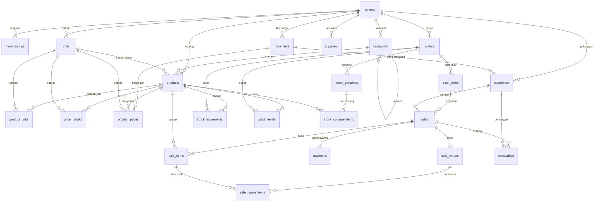

# Arsitektur Database (Supabase / PostgreSQL)

Dokumen ini menjelaskan isi database aplikasi kasir **bengkel-pos**. Tujuannya
supaya skema bisa dibaca tanpa harus menyalakan Supabase lokal (mis. saat audit
kode di GitHub).

| Item | Nilai |
| --- | --- |
| Project ID (lokal) | `bengkel-pos` |
| PostgreSQL | 17.x |
| Schema bisnis | `public` (semua tabel, view, fungsi, policy) |
| Sumber kebenaran | `supabase/migrations/*.sql` (berurutan, tidak boleh diedit) |
| Dump skema terbaru | [`docs/database-schema.sql`](database-schema.sql) |
| Tes RLS/RPC | `supabase/tests/*.test.sql` (pgTAP) |
| Data demo | `supabase/seed.sql` |

Isi `public`: **24 tabel**, **1 view** (`stock_by_outlet`), **26 fungsi**
(termasuk helper RLS dan RPC transaksi).

---

## 1. Konvensi wajib

- **`tenant_id` di setiap tabel bisnis**, RLS aktif, dan indeks selalu diawali
  `tenant_id`. Tidak ada policy `DELETE` untuk `tenants` (tenant tidak boleh
  dihapus lewat API).
- **Policy per perintah**: satu policy `SELECT` untuk semua member
  (`public.is_member(tenant_id)`), policy `INSERT/UPDATE/DELETE` terpisah yang
  memeriksa `public.has_role(tenant_id, array['owner','admin'])` (lihat
  `0002_rls_per_command.sql`).
- **Foreign key komposit** `(tenant_id, x_id) → (tenant_id, id)` supaya baris
  tidak bisa menyambung ke data tenant lain walau ID-nya diketahui.
- **`tenant_id` tidak boleh berubah** — trigger `prevent_tenant_change()`
  dipasang di semua tabel ber-`tenant_id` (`0003`).
- **Uang = `bigint` rupiah bulat**; qty = `numeric` (boleh desimal, mis. 0,5 sak).
- **Stok tidak pernah di-`UPDATE` langsung**. `stock_levels` hanya berubah lewat
  trigger `apply_stock_movement()` saat `INSERT` ke `stock_movements`
  (append-only, `UPDATE`/`DELETE` ditolak trigger).
- **`cost_price` / `unit_cost` tidak boleh terbaca `kasir`/`mekanik`** — RPC
  katalog mengembalikan harga jual saja; view stok tidak memuat kolom biaya.
- **RPC transaksi idempoten** lewat `client_uuid` (unique index), total dihitung
  ulang di server.

---

## 2. ERD ringkas



`memberships.user_id` mengacu ke `auth.users` milik Supabase (skema `auth`,
bukan `public`). `sales.vehicle_id` dan `sales.work_order_id` sudah ada sebagai
kolom untuk Fase 6 (kendaraan/work order) dan belum punya FK.

---

## 3. Tabel per domain

### 3.1 Tenant & akses

| Tabel | Kolom | Catatan |
| --- | --- | --- |
| `tenants` | id, name, business_type, settings, created_at, updated_at, created_by, client_uuid | `business_type` = `bengkel` / `toko_bangunan`; `settings` jsonb (mis. `require_online_for_sale`, pengaturan struk). Dibuat hanya via RPC `create_tenant`. |
| `memberships` | id, tenant_id, user_id, role, outlet_ids, active, created_at, updated_at, created_by | `role` = `owner`/`admin`/`kasir`/`mekanik`/`dev`. Hanya operator (SQL) yang boleh membuat `dev`; owner/admin tidak bisa memberi/mengubah/menghapus role `dev` (`0004`, `0005`). Trigger `protect_last_owner`. |
| `outlets` | id, tenant_id, name, address, phone, created_at, updated_at, created_by | Satu tenant bisa banyak outlet. |
| `audit_logs` | id, tenant_id, entity, entity_id, action, before, after, reason, user_id, created_at | Append-only, hanya `SELECT` (dibaca lewat RPC/trigger internal). |

### 3.2 Katalog & harga

| Tabel | Kolom | Catatan |
| --- | --- | --- |
| `categories` | id, tenant_id, name, parent_id, created_at, updated_at, created_by | `parent_id` mendukung sub-kategori. |
| `units` | id, tenant_id, name, created_at, updated_at, created_by | Satuan: pcs, sak, kg, m, liter, dll. |
| `products` | id, tenant_id, sku, barcode, name, category_id, kind, base_unit_id, track_stock, cost_price, sell_price, min_stock, image_url, active, created_at, updated_at, created_by | `kind` = `barang` / `jasa`. `cost_price` sensitif (tidak boleh dibaca kasir/mekanik). |
| `product_units` | id, tenant_id, product_id, unit_id, factor_to_base, sell_price, barcode, created_at, updated_at, created_by | Konversi satuan (mis. 1 sak = 50 kg). |
| `price_tiers` | id, tenant_id, name, created_at, updated_at, created_by | Tier harga (umum, grosir, bengkel, dst). Default dibuat trigger `seed_default_price_tiers`. |
| `product_prices` | id, tenant_id, product_id, tier_id, unit_id, price, created_at, updated_at, created_by | Harga per tier per satuan. |
| `price_breaks` | id, tenant_id, product_id, unit_id, min_qty, price, created_at, updated_at, created_by | Harga grosir bertingkat berdasarkan qty. |

Harga efektif dihitung server lewat `resolve_price(tenant, product, unit, tier, qty)`.

### 3.3 Pelanggan & pemasok

| Tabel | Kolom | Catatan |
| --- | --- | --- |
| `customers` | id, tenant_id, name, phone, address, tier_id, credit_limit, notes, active, created_at, updated_at, created_by | `credit_limit = 0` berarti **tanpa batas** kredit (keputusan T2.4). |
| `suppliers` | id, tenant_id, name, phone, address, payment_terms_days, active, created_at, updated_at, created_by | Termin pembayaran dalam hari. |

### 3.4 Stok

| Tabel | Kolom | Catatan |
| --- | --- | --- |
| `stock_movements` | id, tenant_id, product_id, outlet_id, qty_base, type, ref_type, ref_id, unit_cost, note, created_at, created_by, client_uuid | **Append-only**. `type`: `in`, `out`, `adjust`, `opname`, `sale`, `return`, `void`. `client_uuid` unik per tenant (idempoten). |
| `stock_levels` | tenant_id, product_id, outlet_id, qty_base, updated_at | Hanya berubah lewat trigger `apply_stock_movement()`. Tanpa policy tulis. |
| `stock_opnames` | id, tenant_id, outlet_id, status, note, created_at, updated_at, created_by, posted_at, posted_by | Status `draft` → `posted`; posting membuat movement. |
| `stock_opname_items` | id, tenant_id, opname_id, product_id, system_qty, counted_qty, difference, created_at | Selisih dihitung saat posting. |

View `stock_by_outlet` (tenant_id, outlet_id, outlet_name, product_id,
product_name, sku, qty_base, min_stock, is_low) — dipakai UI stok menipis,
tanpa kolom biaya.

### 3.5 Penjualan, pembayaran, retur

| Tabel | Kolom | Catatan |
| --- | --- | --- |
| `cash_shifts` | id, tenant_id, outlet_id, cashier_id, opening_cash, opened_at, closed_at, closing_cash_counted, expected_cash, difference, note, client_uuid, close_client_uuid, created_at, updated_at, created_by | Hanya ditulis lewat RPC `open_cash_shift` / `close_cash_shift`. |
| `sales` | id, tenant_id, outlet_id, invoice_no, client_uuid, customer_id, vehicle_id, work_order_id, status, subtotal, discount, tax, total, paid_amount, change_amount, cashier_id, shift_id, sold_at, note, created_at, updated_at, created_by, void_reason, voided_at, voided_by, void_client_uuid | `status` = `paid`/`void`/`needs_review`. Hanya ditulis lewat RPC. Harga & HPP disalin ke `sale_items`. |
| `sale_items` | id, tenant_id, sale_id, product_id, unit_id, qty, qty_base, unit_price, unit_cost, discount, line_total, note, mechanic_id, created_at | `unit_price` + `unit_cost` disalin saat transaksi (laporan tidak membaca harga produk). |
| `payments` | id, tenant_id, sale_id, method, amount, reference, created_at | Metode: `cash`, `transfer`, `qris`, `kartu`, `kredit` (campuran diperbolehkan). |
| `sale_returns` | id, tenant_id, sale_id, reason, client_uuid, total, created_at, created_by | Retur penuh/sebagian; stok masuk lagi lewat movement. |
| `sale_return_items` | id, tenant_id, return_id, sale_item_id, product_id, qty, qty_base, unit_price, line_total, created_at | Tidak boleh melebihi qty yang belum diretur. |
| `receivables` | id, tenant_id, sale_id, customer_id, amount, due_date, status, created_at, updated_at, created_by | Sudah ada di skema; UI/RPC piutang menyusul di Fase 5. |

---

## 4. RLS

Helper (schema `public`, `security definer`, `search_path` dikunci):

| Fungsi | Arti |
| --- | --- |
| `is_member(tenant_id)` | user login punya membership aktif di tenant |
| `has_role(tenant_id, roles text[])` | membership aktif dengan salah satu role |
| `is_dev()` | operator platform (akses lintas tenant) |

Tabel yang **hanya punya policy `SELECT`** (tulis hanya lewat RPC
`security definer` atau trigger):

`audit_logs`, `cash_shifts`, `payments`, `receivables`, `sale_items`,
`sale_return_items`, `sale_returns`, `sales`, `stock_levels`, `stock_movements`,
`stock_opname_items`, `stock_opnames`.

`tenants`: `SELECT` + `UPDATE` (tanpa `INSERT`/`DELETE`; pembuatan lewat
`create_tenant`). Tabel master lain (`categories`, `units`, `products`,
`product_units`, `price_tiers`, `product_prices`, `price_breaks`, `customers`,
`suppliers`, `memberships`, `outlets`) punya 4 policy: `SELECT` member,
`INSERT/UPDATE/DELETE` untuk `owner`/`admin`.

---

## 5. Fungsi & RPC

### Transaksi (atomik + idempoten)

| Fungsi | Kegunaan |
| --- | --- |
| `create_sale(p_client_uuid, p_tenant_id, p_outlet_id, p_customer_id, p_items jsonb, p_payments jsonb, p_shift_id, p_note, p_vehicle_id, p_work_order_id)` | Satu-satunya jalur pembuatan penjualan. Menghitung ulang harga/total di server, memotong stok via `stock_movements`, mencatat pembayaran, mengisi kas shift. |
| `void_sale(p_sale_id, p_reason, p_client_uuid)` | Void penjualan: stok balik, status `void`, audit log. |
| `create_sale_return(p_sale_id, p_items jsonb, p_reason, p_client_uuid)` | Retur sebagian/penuh, stok masuk, total retur dihitung server. |
| `open_cash_shift(p_tenant_id, p_outlet_id, p_opening_cash, p_client_uuid)` | Buka shift kasir. |
| `close_cash_shift(p_shift_id, p_closing_cash_counted, p_note, p_client_uuid)` | Tutup shift + hitung selisih kas. |
| `adjust_stock(p_tenant_id, p_product_id, p_outlet_id, p_qty_base, p_reason, p_client_uuid)` | Penyesuaian stok manual (alasan wajib). |
| `create_stock_opname(p_tenant_id, p_outlet_id, p_note)`, `save_stock_opname_counts(p_opname_id, p_counts jsonb)`, `post_stock_opname(p_opname_id)` | Alur stok opname. |
| `create_tenant(p_client_uuid, p_name, p_business_type, p_outlet_name)` | Onboarding tenant + outlet + owner pertama (satu transaksi). |

### Baca & util

| Fungsi | Kegunaan |
| --- | --- |
| `pos_catalog(p_tenant_id, p_outlet_id, p_tier_id)` | Katalog untuk layar kasir (harga jual + stok, **tanpa** HPP). |
| `resolve_price(p_tenant_id, p_product_id, p_unit_id, p_tier_id, p_qty)` | Harga efektif (tier → grosir → harga satuan). |
| `shift_expected_cash(p_shift_id)` | Kas seharusnya di laci (awal + tunai masuk). |
| `generate_invoice_no(p_tenant_id, p_outlet_id)` | Nomor invoice resmi. |
| `is_member`, `has_role`, `is_dev` | Helper RLS. |
| `prevent_tenant_change`, `protect_last_owner`, `set_created_by`, `set_updated_at`, `apply_stock_movement`, `stock_movements_append_only`, `seed_default_price_tiers` | Trigger internal. |

---

## 6. Cara memeriksa database lokal

Semua perintah Docker **hanya dari WSL Ubuntu** dan hanya menyentuh container
`*bengkel-pos*`.

```bash
# psql interaktif
wsl -d Ubuntu -e docker exec -it supabase_db_bengkel-pos \
  psql -U postgres -d postgres

# daftar tabel + policy
wsl -d Ubuntu -e docker exec supabase_db_bengkel-pos psql -U postgres -d postgres -c \
  "select tablename, policyname, cmd from pg_policies where schemaname='public' order by 1,2;"

# regenerasi dump skema (dipakai dokumen ini)
wsl -d Ubuntu -e sh -c "docker exec supabase_db_bengkel-pos pg_dump -U postgres \
  -d postgres --schema-only --no-owner --no-privileges -n public \
  > /mnt/c/Users/ARBLOK/projects/bengkel/docs/database-schema.sql"
```

Jalankan tes RLS/RPC dengan `supabase test db` (lihat `AGENTS.md` Bagian 5).
